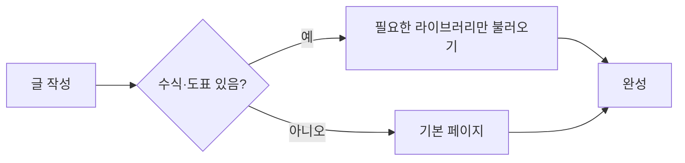
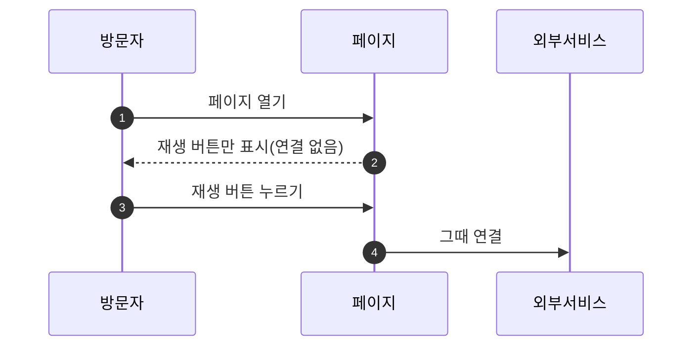
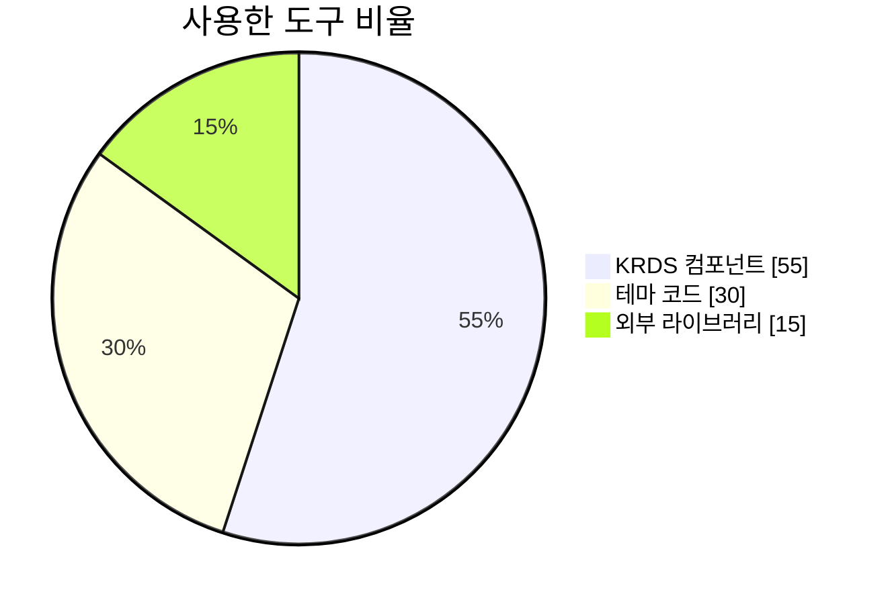

이 페이지의 모든 항목은 **필요한 페이지에서만** 해당 라이브러리를 불러옵니다. 외부 서비스(YouTube, Vimeo, 지도 등)는 **불러오기 버튼을 누르기 전에는 연결하지 않습니다.**

## 수식

본문에 `$$ ... $$`를 쓰면 [KaTeX](https://katex.org)로 그립니다. 문장 안에서는 인라인, 따로 한 문단이면 블록 수식입니다. 이차방정식의 해는 $$x = \frac{-b \pm \sqrt{b^2 - 4ac}}{2a}$$ 입니다.

$$
\int_0^\infty e^{-x^2}\,dx = \frac{\sqrt{\pi}}{2}
\qquad
\sum_{k=1}^{n} k = \frac{n(n+1)}{2}
$$

$$
A = \begin{pmatrix} a & b \\ c & d \end{pmatrix},\quad
\det A = ad - bc
$$

가격처럼 달러 기호를 쓰는 문장은 수식으로 바뀌지 않습니다: 커피 $4와 케이크 $6은 합쳐서 $10입니다.

## Mermaid 다이어그램

`mermaid` 언어의 코드 블록을 쓰면 다이어그램으로 바뀝니다. 화면 모드(기본/선명하게)를 바꾸면 색도 같이 바뀌고, "다이어그램 원문 보기"로 원문을 볼 수 있습니다.







## 차트

`chart` 언어의 코드 블록에 [Chart.js](https://www.chartjs.org) 설정을 **JSON**으로 씁니다. 색은 KRDS 색을 자동으로 쓰고, "데이터 표로 보기"로 같은 값을 표로 읽을 수 있습니다. `title`과 `description`은 접근성을 위한 추가 키입니다.

```chart
{
  "type": "bar",
  "title": "분기별 방문자",
  "description": "1분기부터 4분기까지 방문자 수(천 명)",
  "data": {
    "labels": ["1분기", "2분기", "3분기", "4분기"],
    "datasets": [
      { "label": "2025", "data": [12, 19, 8, 15] },
      { "label": "2026", "data": [14, 22, 17, 25] }
    ]
  }
}
```

```chart
{
  "type": "line",
  "title": "월별 접근성 점수",
  "description": "점수는 0~100",
  "data": {
    "labels": ["1월", "2월", "3월", "4월", "5월", "6월"],
    "datasets": [
      { "label": "밝은 모드", "data": [78, 82, 88, 91, 94, 97] },
      { "label": "선명하게 모드", "data": [70, 76, 85, 90, 95, 98] }
    ]
  },
  "options": { "scales": { "y": { "min": 0, "max": 100 } } }
}
```

```chart
{
  "type": "doughnut",
  "title": "의존성 크기 비율",
  "height": "30rem",
  "data": {
    "labels": ["KRDS", "Mermaid", "Chart.js", "KaTeX"],
    "datasets": [{ "data": [1.2, 3.6, 0.2, 0.6] }]
  }
}
```

## 동영상

### YouTube

```liquid

```



`youtube-nocookie.com` 도메인을 쓰고, 버튼을 누를 때만 연결합니다. `start=30`처럼 시작 시간(초), `url="https://youtu.be/..."`로 주소 전체를 쓸 수도 있습니다.

### Vimeo



### 자체 호스팅 영상(자막 포함)과 오디오

외부 연결이 없는 `<video>`·`<audio>`입니다. 자막(WebVTT)과 대본 링크를 함께 넣을 것을 권합니다.





## 그 밖의 외부 페이지(iframe)

지도, 슬라이드, CodePen 같은 페이지를 넣을 때는 `iframe.html`을 씁니다. 기본으로 `sandbox`가 걸리고 불러오기 버튼 뒤에 있습니다.

{% include embed/iframe.html url="https://www.openstreetmap.org/export/embed.html?bbox=126.9700%2C37.5600%2C126.9850%2C37.5700&layer=mapnik" title="서울 시청 주변 지도" provider="OpenStreetMap" link="https://www.openstreetmap.org/?bbox=126.9700%2C37.5600%2C126.9850%2C37.5700" caption="서울 시청 주변" ratio="16 / 9" %}

## 설정

| 키 | 설명 |
| :--- | :--- |
| 페이지 `math`, `mermaid`, `chart` | `true`면 항상, `false`면 절대 불러오지 않습니다. 지정하지 않으면 본문에 해당 내용이 있을 때만 불러옵니다 |
| `krds.math`, `krds.mermaid`, `krds.chart` | 사이트 전체에서 `false`로 끌 수 있습니다 |
